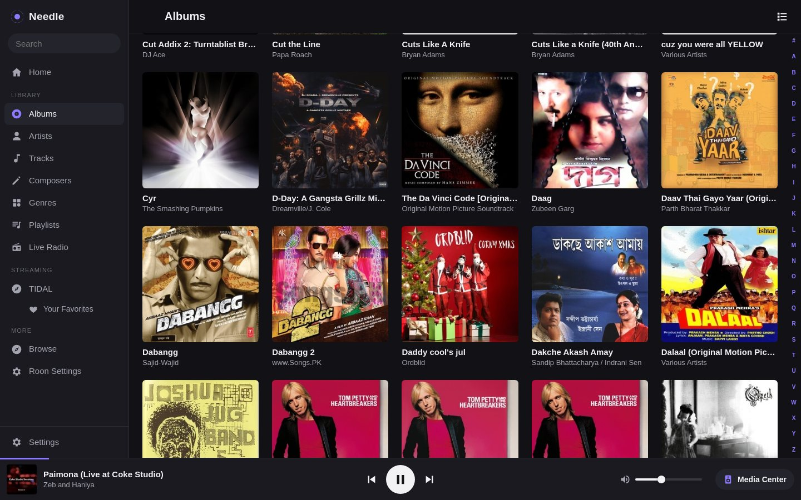
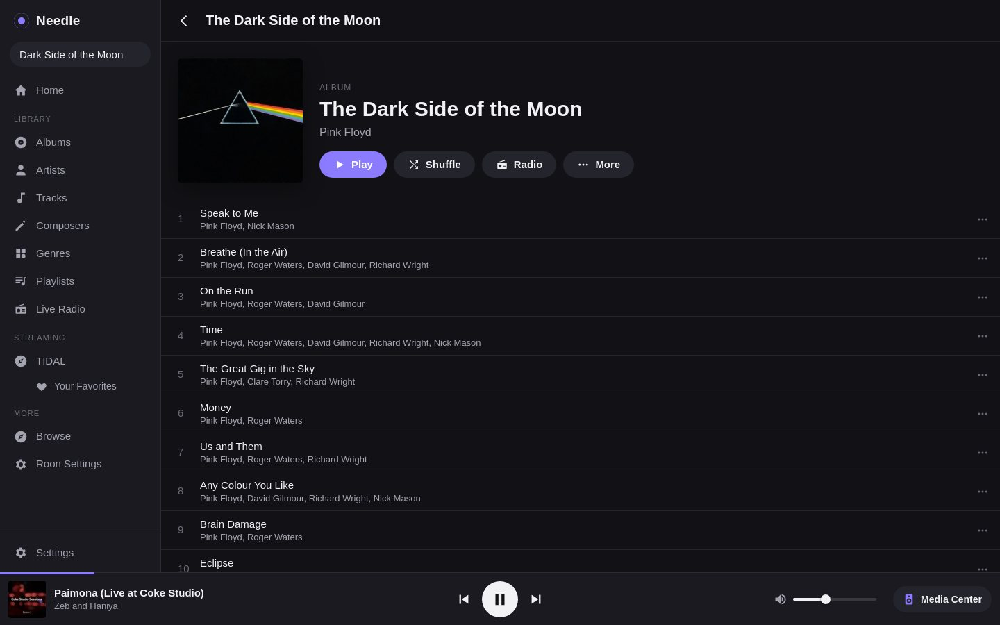
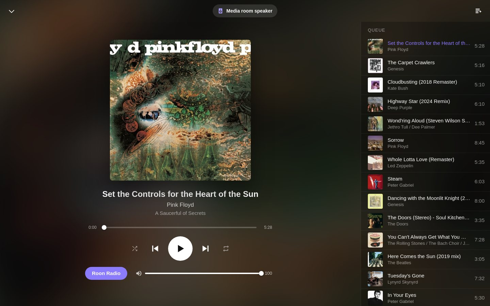
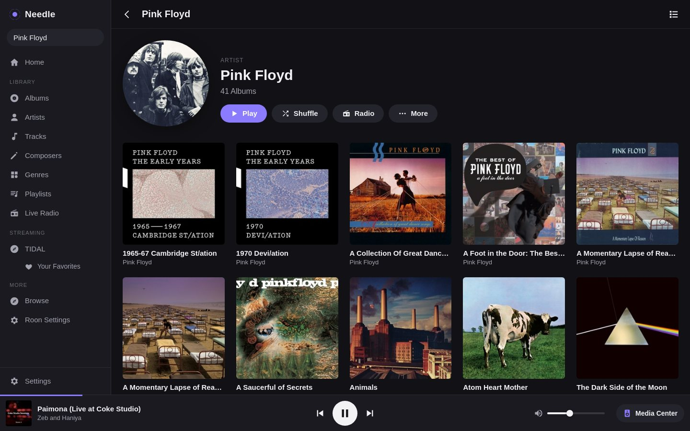
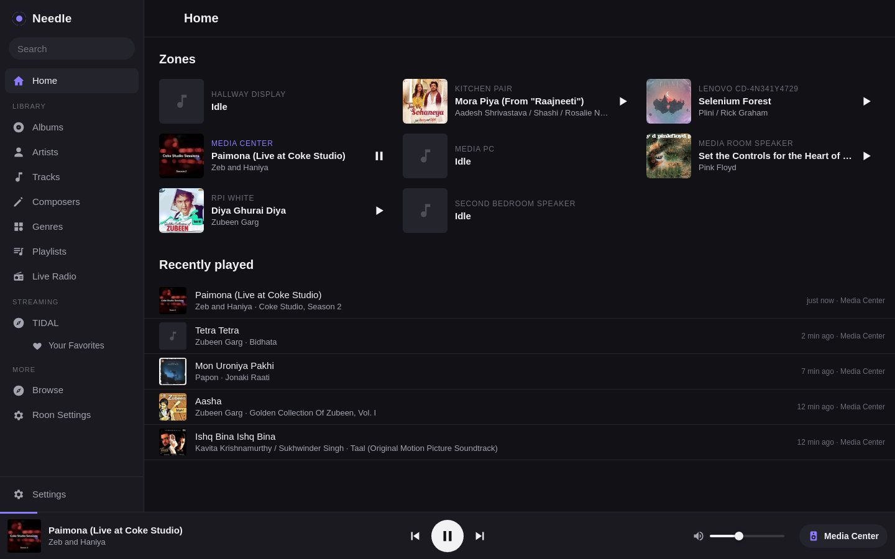
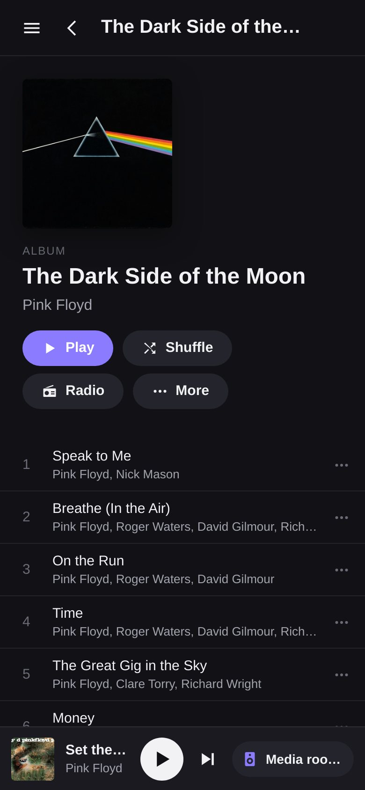
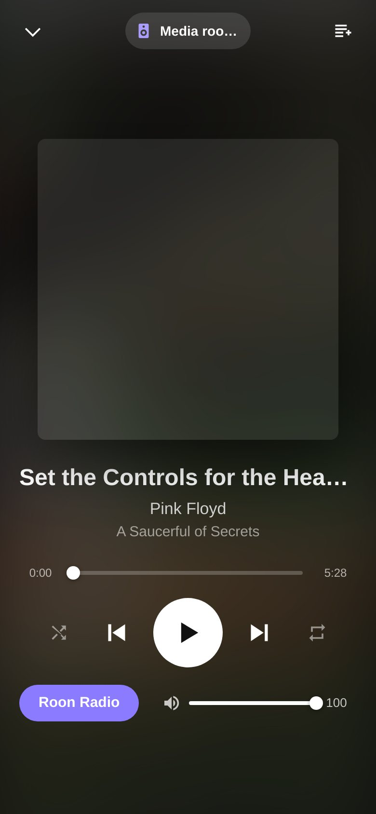

# Needle

A web controller for [Roon](https://roon.app). It runs as a Roon extension and
serves a browser UI for your library, playback, the queue and zones, so any browser
on your network becomes a Roon remote: a laptop, an Android tablet, a phone, or an
old iPad on the wall. The client is plain ES5 with no build step, so it still runs
on iOS 9.



| | |
|---|---|
|  |  |
|  |  |

<p>
  
  
</p>

## Features

- **Library:** albums, artists, tracks, composers, genres, playlists, live radio,
  your streaming services (TIDAL, Qobuz) including their favorites, and the full
  Roon browse tree; search
- **A–Z jump bar** on big lists. It jumps straight to a letter without loading the
  thousands of items before it
- **Album, artist and genre pages** with Play, Shuffle, Radio and the full action
  menu (Play Now, Add Next, Queue, Start Radio) on every item
- **Now Playing:** seek, shuffle, repeat, Roon Radio, volume and the live queue (tap
  a track to play from there); tap the artist or album to open it
- **Home:** every zone at a glance with play/pause, and what played recently
- **Zones:** switch, per-output volume and mute, transfer the queue, group and
  ungroup, pause all, and power on / standby for devices Roon can switch (an AV
  receiver, say)
- **Roon settings:** switch Roon profiles, artist and composer sort order
- Each browser keeps its own place while browsing; pages load as you scroll and art
  loads only near the viewport, so it stays quick on old hardware
- Dark, light or system theme; add it to your home screen and it runs full screen;
  keyboard shortcuts on desktop (Space, `/`, Esc)

### What Roon doesn't let extensions do

Needle can only do what Roon's extension API allows. These are not available to any
extension, so they're not in Needle: hearts (liked tracks, albums and artists),
Focus filters and sorting, editing playlists or the queue, tags, credits, reviews,
bios and lyrics, Roon's own play history, and DSP or device setup. Needle keeps its
own *Recently played* list from what it sees playing.

## Install

Needle needs to reach your Roon Core on port 9330. Use the Core's IP address as
`ROON_HOST`; discovery works only when Needle and the Core share a network segment.

**Docker Compose** ([docker-compose.yml](docker-compose.yml)):

```yaml
services:
  needle:
    image: ghcr.io/priyankub/needle:latest
    container_name: needle
    restart: unless-stopped
    ports:
      - "8080:8080"
    environment:
      ROON_HOST: "192.168.1.10"   # your Roon Core
    volumes:
      - needle-data:/data
volumes:
  needle-data:
```

```sh
docker compose up -d
```

**docker run:**

```sh
docker run -d --name needle --restart unless-stopped \
  -p 8080:8080 \
  -e ROON_HOST=192.168.1.10 \
  -v needle-data:/data \
  ghcr.io/priyankub/needle:latest
```

Then, in Roon, open **Settings → Extensions** and click **Enable** next to
**Needle**, and browse to `http://<docker host>:8080`. Images are built for amd64 and
arm64 (Raspberry Pi 4/5).

**Without Docker:** Node.js 18 or later.

```sh
git clone https://github.com/priyankub/needle && cd needle
npm ci --omit=dev
ROON_HOST=192.168.1.10 npm start
```

## How it works

```
 browser ──HTTP/WebSocket──▶ Needle (Node) ──WebSocket──▶ Roon Core :9330
                                 extension API: transport, browse, image
```

The server keeps one connection to the Core, pushes zone and seek changes to every
open browser over a WebSocket, and proxies album art (resized by the Core, cached in
memory).

## Configuration

| Variable | Default | |
|---|---|---|
| `ROON_HOST` | (empty) | Core address. Empty uses multicast discovery, which usually doesn't cross VLANs |
| `ROON_PORT` | `9330` | |
| `EXTENSION_ID` | `net.needle.remote` | Give a second (dev) instance its own id: two instances sharing one keep knocking each other off the Core |
| `AUTH_MODE` | `open` | `open` or `proxy` (see below) |
| `AUTH_USER_HEADER` | `X-Forwarded-User` | `proxy` mode: user header set by the proxy's forward-auth |
| `AUTH_ROUTE_VALUE` | `forward-auth` | `proxy` mode: value of `X-Needle-Auth` that marks the forward-auth route |
| `PROXY_SECRET` | (empty) | `proxy` mode: if set, every request must carry it in `X-Needle-Proxy` |
| `SECURE_COOKIES` | `true` | Set `false` if serving paired devices over plain HTTP |
| `ALLOWED_ORIGINS` | (empty) | Extra origins allowed to open the WebSocket |
| `PORT` | `8080` | |
| `DATA_DIR` | `/data` | Extension token, play history, paired devices |

## Access

**`open` (default).** No login, the same as Roon itself: anything on your network
can run a Roon remote, and anything that can reach Needle can use it. Keep it on
your LAN. Needle still only accepts commands and WebSocket connections from its own
page, so a website open in your browser can't drive it.

**`proxy`.** For putting Needle behind a login, or anywhere beyond a trusted LAN.
A reverse proxy authenticates people; Needle lets in:

1. **People** who passed the proxy's forward-auth. The forward-auth route sets
   `X-Needle-Auth: forward-auth` (and the user header, if the forward-auth sends
   one), so setups that let trusted networks through without a login still work.
2. **Paired devices**: browsers too old for the login page, such as a wall-mounted
   tablet. A signed-in person opens **Settings → Pair a device** and gets a 6-digit
   code that lasts five minutes and works once. On the tablet, open `/link` and type
   the code; the tablet gets a long-lived device cookie. Devices are listed and
   revoked under **Settings → Paired devices**. A paired device can't pair others.

Two proxy routes do this. Traefik example:

```yaml
# forward-auth route
- traefik.http.routers.needle.rule=Host(`music.example.com`)
- traefik.http.routers.needle.middlewares=forward-auth, needle-proxy
- traefik.http.middlewares.needle-proxy.headers.customrequestheaders.X-Needle-Proxy=change-me
- traefik.http.middlewares.needle-proxy.headers.customrequestheaders.X-Needle-Auth=forward-auth
# device route: no forward-auth; Needle checks the cookie itself
- traefik.http.routers.needle-device.rule=Host(`music.example.com`) && (HeaderRegexp(`Cookie`, `(^|;\s*)needle_device=`) || PathPrefix(`/link`))
- traefik.http.routers.needle-device.priority=1000
- traefik.http.routers.needle-device.middlewares=needle-device
- traefik.http.middlewares.needle-device.headers.customrequestheaders.X-Needle-Proxy=change-me
- traefik.http.middlewares.needle-device.headers.customrequestheaders.X-Forwarded-User=
- traefik.http.middlewares.needle-device.headers.customrequestheaders.X-Needle-Auth=
```

The device route must blank `X-Forwarded-User` and `X-Needle-Auth`, or a client
could send them itself. `PROXY_SECRET` stops anything that reaches the container
directly (other containers on the proxy network) from doing the same.

### Old iPads

iOS 9 doesn't trust current Let's Encrypt roots: install ISRG Root X1 as a profile
first (open `https://letsencrypt.org/certs/isrgrootx1.der` in Safari). Home-screen
web apps on old iOS keep their own cookies, so add `/link` to the home screen and
pair from there; the page also keeps a copy of the device token to restore a lost
cookie.

## Development

```sh
npm install
EXTENSION_ID=net.needle.remote.dev ROON_HOST=192.0.2.10 npm start
```

`web/` is served as is. Keep `web/app.js` ES5 (no `let`/`const`, arrow functions,
template strings or `fetch`); check it with
`npx acorn --ecma5 --silent web/app.js`.

## License

MIT
